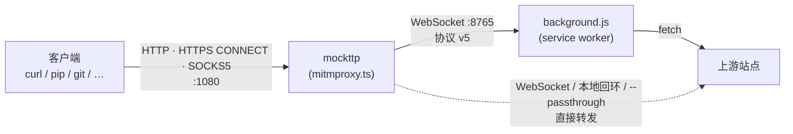
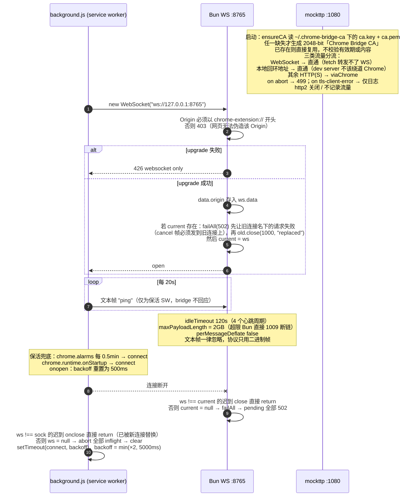
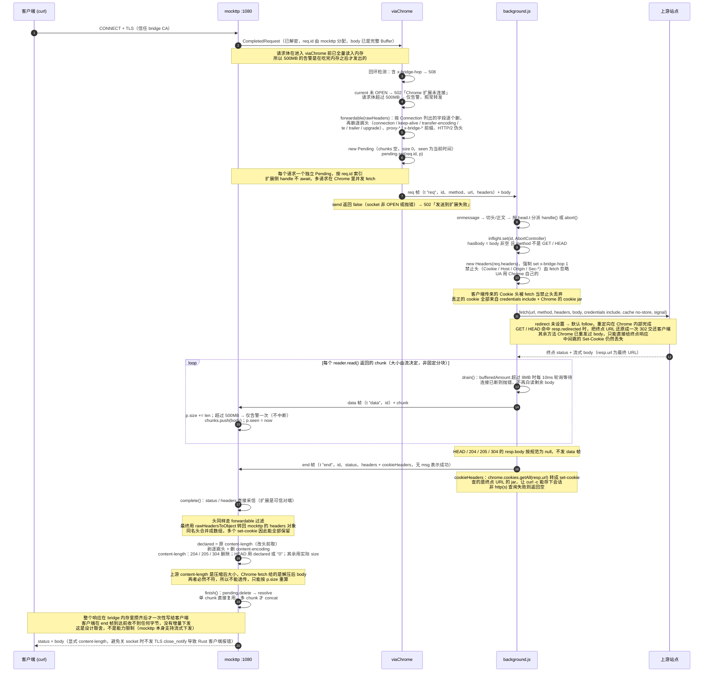
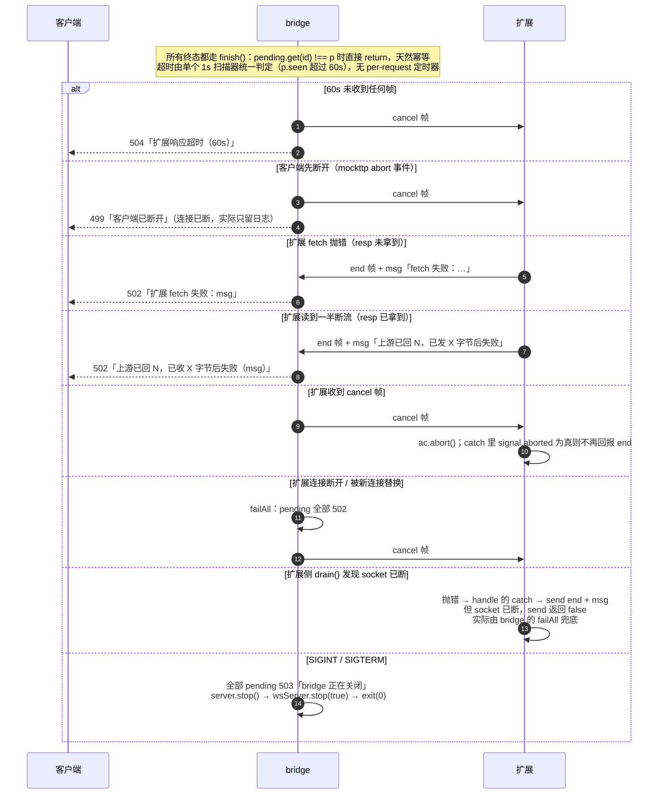
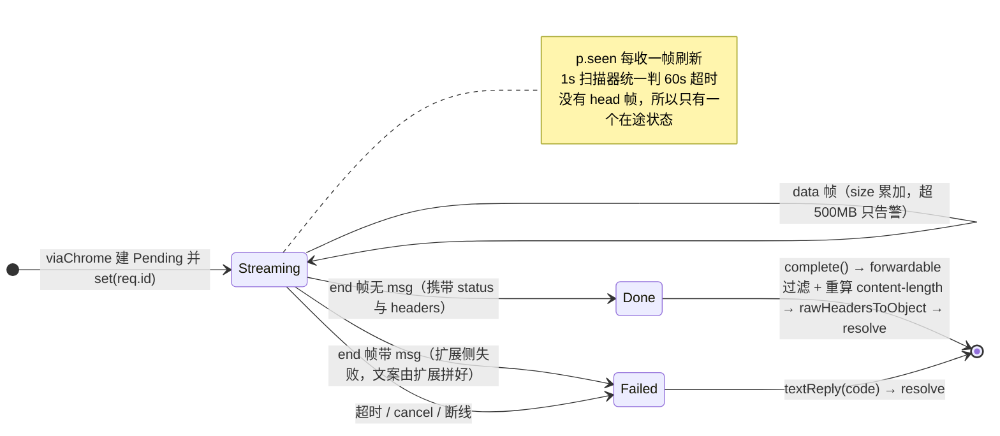

# chrome-bridge

把本机 HTTP(S) 流量交给 Chrome 代发：本地起一个代理端口，除本地回环地址外，所有请求都通过 WebSocket 转给 Chrome 扩展，由扩展用 `fetch` 发出。出网能力、Cookie、UA、代理链全部沿用 Chrome 自己的。

适合的场景：本机没有直连出网能力、但 Chrome 有；需要复用浏览器已登录的会话；需要绕过只对浏览器放行的网络策略。

## 组成

| 文件 | 角色 |
| --- | --- |
| `mitmproxy.ts` | bridge 本体。Bun 进程，mockttp 代理（HTTP / HTTPS CONNECT / SOCKS5 共用一个端口）+ WebSocket 服务端 |
| `background.js` | Chrome 扩展 service worker。连 bridge，用 Chrome 的 `fetch` 代发请求，把响应流回 bridge |
| `manifest.json` | MV3 清单，权限 `alarms` + `cookies`，host 权限 `<all_urls>` |
| `123.sh` | 把 bridge CA 追加进系统证书链，并导出 `*_CA_BUNDLE` 系列环境变量 |



流量分流：

- **WebSocket** → 直通。`fetch` 转发不了 WS。
- **本地回环地址** → 直通。dev server 不该绕道 Chrome。判定用 mockttp 的 `isLocalhostAddress`，覆盖 `localhost` / `*.localhost` / `127.0.0.0/8` / `::1`。
- **其余 HTTP(S)** → 交给 Chrome。
- **`--passthrough` 命中的域名** → TLS 层裸转发，客户端看到真实证书，不需要信任 bridge 的 CA。这是证书 pinning 应用和 Apple 系统服务的唯一可行路径，代价是这些域名不经过 Chrome，要求本机对其有直连出网能力。

## 运行

```bash
ulimit -n 10240 && bun mitmproxy.ts \
    --port 1080 \
    --ws 127.0.0.1:8765 \
    --ca-dir ~/.chrome-bridge-ca \
    --passthrough "*.apple.com,*.icloud.com"
```

- 文件描述符上限由外部 shell 的 `ulimit` 负责，程序内不调整 `RLIMIT_NOFILE`：macOS 默认 soft limit 只有 256，超过 `kern.maxfilesperproc` 会失败。
- 首次启动在 `--ca-dir` 下生成 2048-bit「Chrome Bridge CA」（`ca.key` + `ca.pem`）。任一文件缺失才重新生成，已存在则直接复用，**不校验有效期或内容**。生成后需要加入系统信任（`123.sh`）。
- 扩展侧：`chrome://extensions` 加载本目录，确认 service worker 日志出现 `[bridge] connected`。
- 客户端把代理指向 `127.0.0.1:1080`。

## 协议 v5

帧格式：`[单行 JSON 头]\n[正文]`。WebSocket 消息本身即边界，没有长度前缀；`JSON.stringify` 不产生裸换行，所以第一个 `\n` 就是头与正文的分界。

| 方向 | 帧类型 | 载荷 |
| --- | --- | --- |
| bridge → 扩展 | `req` | `id` / `method` / `url` / `headers` + 正文 |
| bridge → 扩展 | `cancel` | `id` |
| 扩展 → bridge | `data` | `id` + 正文 |
| 扩展 → bridge | `end` | 二选一：`id` / `status` / `headers`，或 `id` / `msg`（扩展侧失败） |

没有 `head` 帧：bridge 必须攒齐整个 body 才能 resolve，status / headers 提前到达也用不上，统一由 `end` 帧携带，省掉一套「头到了没到」的状态与分支。

心跳是文本帧 `"ping"`，不占帧类型，也不占用二进制帧的编解码路径。协议只用二进制帧，其余文本帧一律忽略。两端互为可信对端（同一台机器、同一条回环 WebSocket），帧只做 JSON 解析，字段形状由协议保证；唯一保留的信任边界是升级时的 `Origin` 检查——它挡的是任意网页，不是本机进程。

## ① 连接期



只允许扩展连接：普通网页无法伪造 `chrome-extension://` 的 Origin。同一时刻只保留一条连接，新连接会顶掉旧的，旧连接名下的在途请求立即失败而不是等超时。

## ② 请求主路径



## ③ 错误与取消

所有终态都走 `finish()`：`pending.get(id) !== p` 时直接 return，天然幂等。超时由单个 1s 扫描器统一判定（`p.seen` 超过 60s），没有 per-request 定时器——每收一帧重置 timer 会让大响应产生上千次定时器创建/销毁。



「上游已响应但正文断了」和「根本没连上」的区别只能由扩展拼进 `msg`：只有它知道上游状态码和已发字节数。

## ④ Pending 状态机



## 关键取舍与已知限制

**响应整块缓冲。** bridge 必须攒齐整个 body 才能 resolve，客户端在 `end` 帧到达前收不到任何字节。这是为了让「没有 head 帧」这套简化协议成立，不是能力限制——mockttp 本身支持流式下发。超过 500MB（请求体、响应体各自）只打一条 `[size]` 告警，不中断：拒绝会让大文件传输直接失败，而内存占用在整块缓冲这个设计下本来就无法靠上限挡住。

**大小告警发生在吃完内存之后。** 请求体在进入 `viaChrome` 前已被 mockttp 全量读入内存，所以 500MB 的告警只能提示、不能挡住内存占用。`maxBodySize` 故意不设：它超限时清空 body 而不报错，大请求会被静默变成空 body。

**`content-length` 必须重算。** 上游声明的是压缩后大小，Chrome `fetch` 给的是解压后 body，两者必然不符。桥接后 `content-encoding` 也被删掉。同时必须显式写回 `content-length`：callback 返回 headers 时 mockttp 会调 `dropDefaultHeaders()`，把 Node 默认的 `content-length` / `transfer-encoding` 一起删掉；此时若不再写回，body 只能靠关闭连接界定，而 mockttp 关闭 socket 时不发 TLS `close_notify`，rustls / hyper 会直接报 `peer closed connection without sending TLS close_notify`（pixi、uv、pip 全部中招）。`curl` 按 RFC 7230 §3.3.3 用 EOF 兜底，所以只有 Rust 客户端会失败。

**Cookie 只能单向。** 客户端传来的 `Cookie` 头被 `fetch` 当禁止头丢弃，真正的 cookie 全部来自 `credentials: include` + Chrome 的 cookie jar。反方向上，扩展用 `chrome.cookies.getAll(resp.url)` 把终点 URL 的 cookie 转成 `set-cookie` 回传，`curl -c` 才能存下会话。

**重定向只对 GET / HEAD 可见。** `redirect` 未设置，默认 follow，重定向在 Chrome 内部完成；扩展看到 `resp.redirected` 就把终点 URL 还原成一次 302 交还客户端，客户端自己跟完剩下的跳。其余方法（POST 等）Chrome 已经重发过 body，原始状态码是 301/302/303 还是 307/308 无从得知，编一个会让客户端选错方法，只能直接给终点响应。任何情况下中间跳的 `Set-Cookie` 都拿不到。`redirect: "manual"` 是死路：service worker 里只给 opaqueredirect（status 0、无 header）。

**回环检测是固定头名。** 扩展强制 `x-bridge-hop: 1`，bridge 见到该头即判 508（Chrome 的代理指向了 bridge 本身）。客户端自己带这个头会被误判，换随机名可解，但保持固定名更简单。

**`--passthrough` 要求直连出网。** 透传由 Bun 进程直接连上游，不走 Chrome。若本机只靠 Chrome 出网，透传会 `ECONNREFUSED`，反而不如不解密。

**TLS 失败原因在 Bun 下基本不可信。** mockttp 的 `getCauseFromError` 靠正则匹配 Node 的错误文案（`alert unknown ca` / `ERR_SSL_SSLV3_ALERT_BAD_CERTIFICATE`），Bun 给的是 OpenSSL 常量名（`TLSV1_ALERT_UNKNOWN_CA`），一条都对不上，于是「客户端不信任 CA」全被归成 `unknown`；TLS 1.3 的 alert 还是加密的，Bun 只能看到 `BAD_PACKET_LENGTH`。排查时：`reset` / `closed` 是客户端一个 alert 都没发就掐断连接，装 CA 永远解决不了，得往 pinning 或非 HTTP 协议上查。
