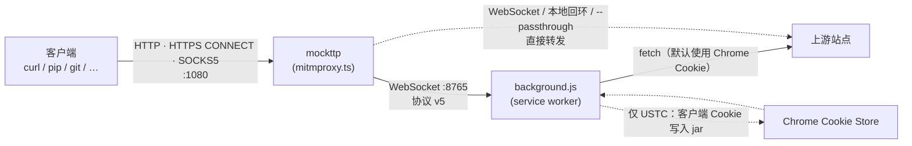
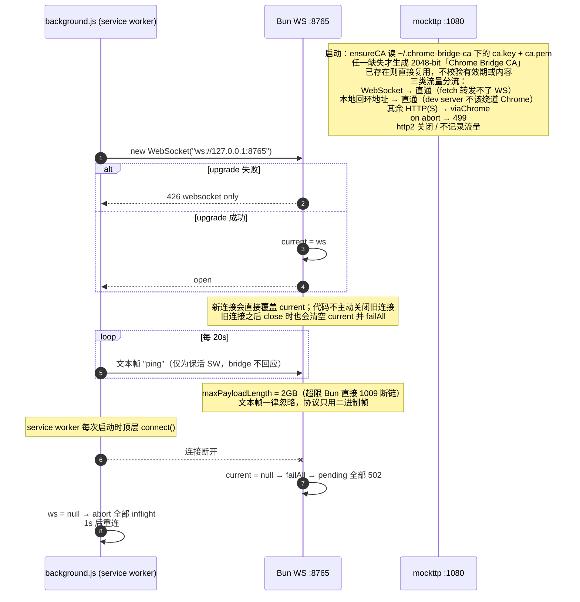
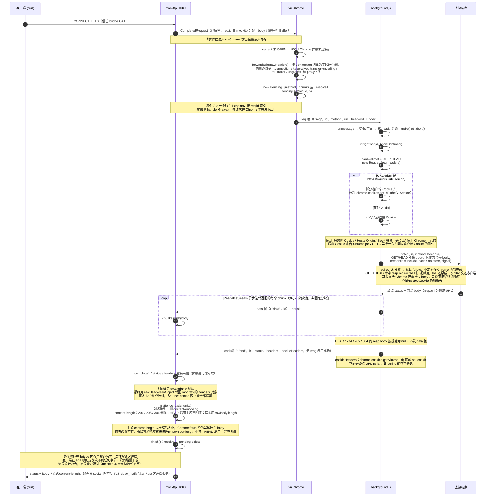
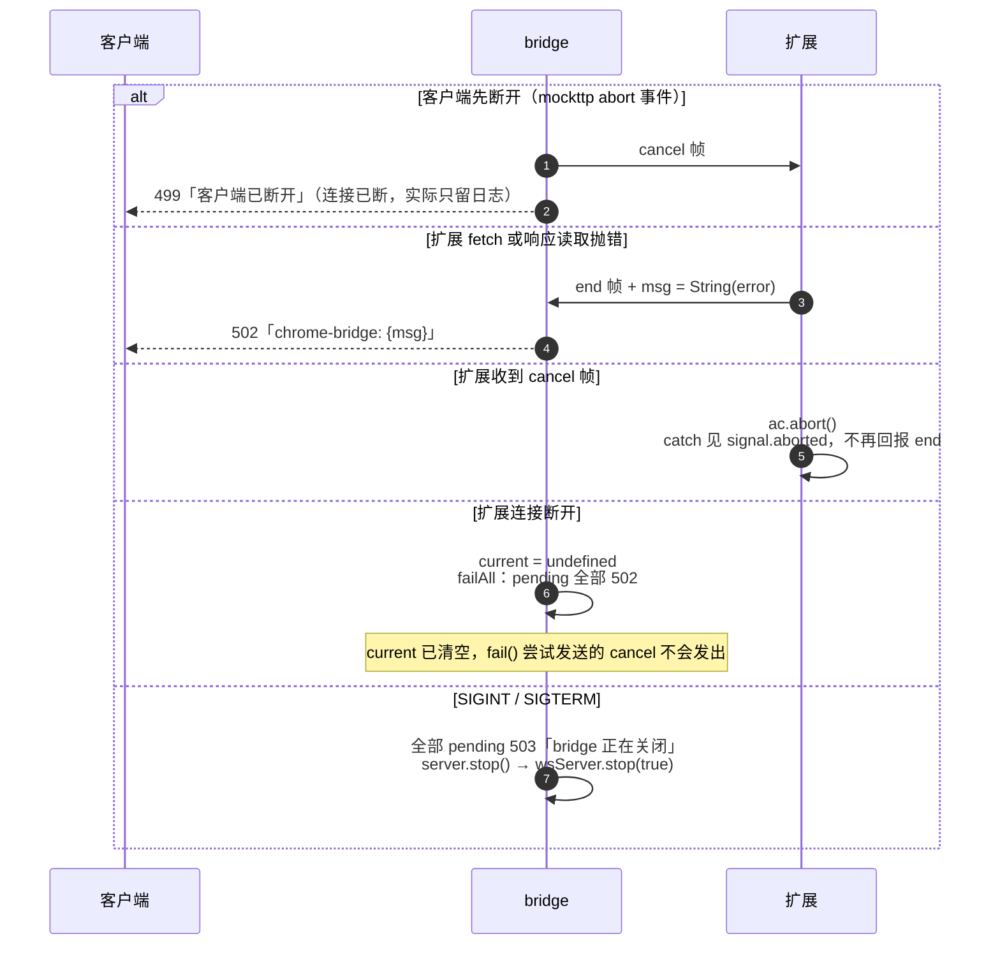
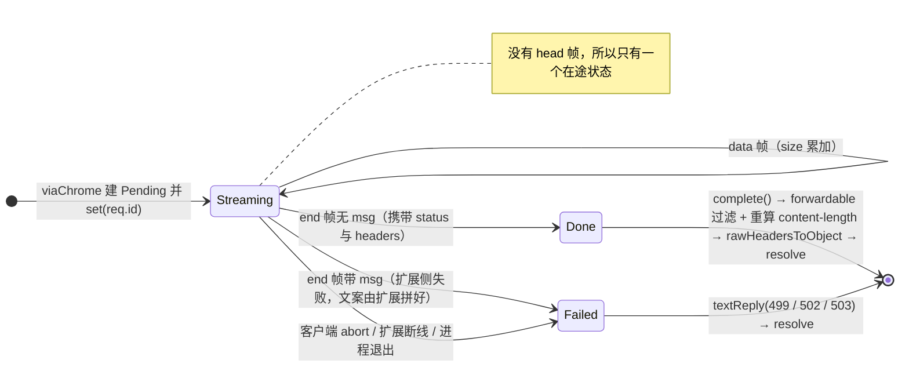

# chrome-bridge

把本机 HTTP(S) 流量交给 Chrome 代发：本地起一个代理端口，除本地回环地址外，所有请求都通过 WebSocket 转给 Chrome 扩展，由扩展用 `fetch` 发出。出网能力、UA、代理链沿用 Chrome；Cookie 默认来自 Chrome，`https://mirrors.ustc.edu.cn` 还会先把客户端 Cookie 写入 Chrome。

适合的场景：本机没有直连出网能力、但 Chrome 有；需要复用浏览器已登录的会话；需要绕过只对浏览器放行的网络策略。

## 组成

| 文件                        | 角色                                                                                                |
| --------------------------- | --------------------------------------------------------------------------------------------------- |
| `mitmproxy.ts`            | bridge 本体。Bun 进程，mockttp 代理（HTTP / HTTPS CONNECT / SOCKS5 共用一个端口）+ WebSocket 服务端 |
| `extension/background.js` | Chrome 扩展 service worker。连 bridge，用 Chrome 的 `fetch` 代发请求，把响应流回 bridge           |
| `extension/manifest.json` | MV3 清单，权限 `cookies`，host 权限 `<all_urls>`                                                |
| `assets/cacert.sh`           | 把 bridge CA 追加进系统证书链，并导出 `*_CA_BUNDLE` 系列环境变量                                  |



流量分流：

- **WebSocket** → 直通。`fetch` 转发不了 WS。
- **本地回环地址** → 直通。dev server 不该绕道 Chrome。判定用 mockttp 的 `isLocalhostAddress`，覆盖 `localhost` / `*.localhost` / `127.0.0.0/8` / `::1`。
- **其余 HTTP(S)** → 交给 Chrome。
- **`--passthrough` 命中的域名** → TLS 层裸转发，客户端看到真实证书，不需要信任 bridge 的 CA。这是证书 pinning 应用和 Apple 系统服务的唯一可行路径，代价是这些域名不经过 Chrome，要求本机对其有直连出网能力。

## 运行

```bash
ulimit -n 10240 && bun mitmproxy.ts \
    --port 1080 \
    --ws 127.0.0.1:8765 \
    --ca-dir ~/.chrome-bridge-ca \
    --passthrough "*.apple.com,*.icloud.com"
```

- 文件描述符上限由外部 shell 的 `ulimit` 负责，程序内不调整 `RLIMIT_NOFILE`：macOS 默认 soft limit 只有 256，超过 `kern.maxfilesperproc` 会失败。
- 首次启动在 `--ca-dir` 下生成 2048-bit「Chrome Bridge CA」（`ca.key` + `ca.pem`）。任一文件缺失才重新生成，已存在则直接复用，**不校验有效期或内容**。生成后需要加入系统信任（`assets/cacert.sh`）。
- 扩展侧：`chrome://extensions` 加载 `extension/` 目录，确认 service worker 日志出现 `[bridge] connected`。service worker 每次启动都会在顶层执行 `connect()`。
- 客户端把代理指向 `127.0.0.1:1080`。

## 协议 v5

帧格式：`[单行 JSON 头]\n[正文]`。WebSocket 消息本身即边界，没有长度前缀；`JSON.stringify` 不产生裸换行，所以第一个 `\n` 就是头与正文的分界。

| 方向           | 帧类型     | 载荷                                                                         |
| -------------- | ---------- | ---------------------------------------------------------------------------- |
| bridge → 扩展 | `req`    | `id` / `method` / `url` / `headers` + 正文                           |
| bridge → 扩展 | `cancel` | `id`                                                                       |
| 扩展 → bridge | `data`   | `id` + 正文                                                                |
| 扩展 → bridge | `end`    | 二选一：`id` / `status` / `headers`，或 `id` / `msg`（扩展侧失败） |

没有 `head` 帧：bridge 必须攒齐整个 body 才能 resolve，status / headers 提前到达也用不上，统一由 `end` 帧携带，省掉一套「头到了没到」的状态与分支。

心跳是文本帧 `"ping"`，不占帧类型，也不占用二进制帧的编解码路径。协议只用二进制帧，其余文本帧一律忽略。两端默认运行在可信 LAN，帧只做 JSON 解析，字段形状由协议保证。

## ① 连接期



bridge 与扩展各维持一条连接。WebSocket 不校验来源，默认监听范围内的网络可信。

## ② 请求主路径



## ③ 错误与取消

所有 bridge 侧终态都走 `finish()`：先 resolve，再从 `pending` 删除请求。



扩展把 `fetch` 或响应流读取抛出的异常直接 `String(error)` 后放入 `msg`；协议不单独携带失败阶段、上游状态码或已发送字节数。

## ④ Pending 状态机



## 关键取舍与已知限制

**响应整块缓冲。** bridge 必须攒齐整个 body 才能 resolve，客户端在 `end` 帧到达前收不到任何字节。这是为了让「没有 head 帧」这套简化协议成立，不是能力限制——mockttp 本身支持流式下发。`maxBodySize` 故意不设：它超限时清空 body 而不报错，大请求会被静默变成空 body。

**`content-length` 必须重算。** 上游声明的是压缩后大小，Chrome `fetch` 给的是解压后 body，两者必然不符。桥接后 `content-encoding` 也被删掉。同时必须显式写回 `content-length`：callback 返回 headers 时 mockttp 会调 `dropDefaultHeaders()`，把 Node 默认的 `content-length` / `transfer-encoding` 一起删掉；此时若不再写回，body 只能靠关闭连接界定，而 mockttp 关闭 socket 时不发 TLS `close_notify`，rustls / hyper 会直接报 `peer closed connection without sending TLS close_notify`（pixi、uv、pip 全部中招）。`curl` 按 RFC 7230 §3.3.3 用 EOF 兜底，所以只有 Rust 客户端会失败。

**Cookie 默认单向，USTC 镜像例外。** `fetch` 会忽略客户端直接传入的 `Cookie` 头，请求 cookie 默认来自 `credentials: include` + Chrome 的 cookie jar。仅当请求 origin 严格等于 `https://mirrors.ustc.edu.cn` 时，扩展会先按 `;` 拆分客户端 Cookie，并用 `chrome.cookies.set` 写入 Chrome（`Path=/`、`Secure`），再发起请求；其他站点不会导入。反方向上，扩展用 `chrome.cookies.getAll(response.url)` 把终点 URL 的 cookie 转成 `set-cookie` 回传，`curl -c` 才能存下会话。

**重定向只对 GET / HEAD 可见。** `redirect` 未设置，默认 follow，重定向在 Chrome 内部完成；扩展看到 `resp.redirected` 就把终点 URL 还原成一次 302 交还客户端，客户端自己跟完剩下的跳。其余方法（POST 等）Chrome 已经重发过 body，原始状态码是 301/302/303 还是 307/308 无从得知，编一个会让客户端选错方法，只能直接给终点响应。任何情况下中间跳的 `Set-Cookie` 都拿不到。`redirect: "manual"` 是死路：service worker 里只给 opaqueredirect（status 0、无 header）。

**`--passthrough` 要求直连出网。** 透传由 Bun 进程直接连上游，不走 Chrome。若本机只靠 Chrome 出网，透传会 `ECONNREFUSED`，反而不如不解密。
